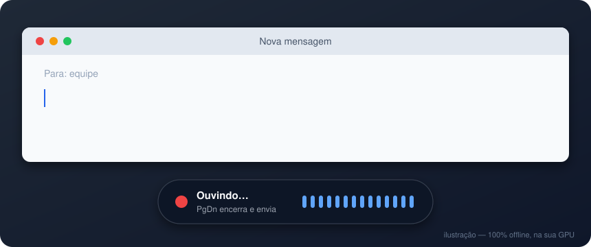

<h1 align="center">VozFlow</h1>

<p align="center">
  <b>Ditado por voz para Windows — offline, em qualquer programa, enquanto você fala.</b><br>
  Clique no campo, aperte a tecla e fale: o texto vai sendo escrito ali mesmo.
</p>

<p align="center">
  
  
  
  
  
  
</p>

<p align="center">
  
</p>

<p align="center">
  <a href="https://github.com/clauberteixeira/VozFlow/releases/latest"><b>⬇ Baixar a versão mais recente</b></a>
</p>

---

## A ideia

Digitar é o gargalo de muita coisa no computador: responder mensagem, escrever
e-mail, documentar, preencher sistema. Falar é três a quatro vezes mais rápido
— mas as ferramentas de ditado costumam exigir internet, um aplicativo
específico, ou mandar a sua voz para um servidor de terceiros.

O **VozFlow** resolve isso de um jeito simples:

- **funciona em qualquer programa** — WhatsApp Web, Gmail, VS Code, Word, campo
  de busca, sistema interno. Não precisa de integração nenhuma: ele escreve
  onde o cursor estiver;
- **escreve enquanto você fala**, não só no fim — você vê a frase se formando;
- **roda inteiro na sua máquina.** O reconhecimento de voz (Whisper) usa a sua
  placa de vídeo. Nenhum áudio sai do computador, sem conta, sem assinatura,
  sem custo por minuto;
- **fica fora do caminho:** um ícone na bandeja, uma tecla para começar e uma
  janelinha que nunca rouba o foco do seu campo.

---

## Índice

- [O que ele faz](#o-que-ele-faz)
- [Instalação](#instalação)
- [Como usar](#como-usar)
- [Atualização automática](#atualização-automática)
- [Como o texto aparece enquanto você fala](#como-o-texto-aparece-enquanto-você-fala)
- [Voz de fundo](#voz-de-fundo)
- [O que já foi feito](#o-que-já-foi-feito)
- [Números](#números)
- [Configuração](#configuração)
- [Documentação completa](#documentação-completa)
- [Estrutura do projeto](#estrutura-do-projeto)
- [Licença](#licença)

---

## O que ele faz

| | |
|---|---|
| **Escrita ao vivo** | O texto entra no campo em foco enquanto você fala, sem precisar apagar nada depois |
| **100% offline** | O modelo roda na sua GPU (ou na CPU, se não houver placa NVIDIA). Nenhum áudio sai da máquina |
| **Atalho global** | Funciona em qualquer programa. Pode ser uma tecla só (`PgDn`, por exemplo) |
| **Dois pares de atalhos** | Uma tecla que só escreve, outra que escreve **e já envia** (aperta Enter) |
| **Trava de janela** | Trocou de janela no meio da fala? O texto espera, não vaza para o lugar errado |
| **Microfone automático** | Segue o microfone padrão do Windows a cada ditada — ligou o fone, ele passa a usar |
| **Calibração** | Mede o seu ambiente e a sua voz, e corta som fraco e distante |
| **Anti-alucinação** | Três camadas contra as falhas clássicas do Whisper (texto inventado no silêncio, repetição) |
| **Vocabulário próprio** | Nomes, siglas e jargão do seu contexto entram certos na transcrição |
| **Atualiza sozinho** | Versão nova é baixada, conferida e instalada sem você fazer nada |
| **Histórico opcional** | Guarda o que foi ditado (ou não, você escolhe), limpando sozinho o que é antigo |

---

## Instalação

1. Baixe o `VozFlow-<versão>-instalador.exe` da
   **[versão mais recente](https://github.com/clauberteixeira/VozFlow/releases/latest)**
   e execute.
2. *"O Windows protegeu o computador"?* O instalador ainda não tem assinatura
   digital do Windows. Clique em **Mais informações → Executar assim mesmo**.
3. Na primeira abertura, o modelo de reconhecimento é baixado uma única vez
   (1,6 GB com placa NVIDIA, ~145 MB sem), com o progresso na janelinha.

O instalador **não pede administrador**, instala na pasta do seu usuário e
aparece em Aplicativos Instalados para desinstalar. Depois disso você não
precisa mais instalar nada: as versões novas chegam sozinhas.

> **Sem placa NVIDIA?** Funciona: o app escolhe sozinho um modelo menor, que
> roda bem na CPU.

Requisitos, instalação manual e rodar a partir do código em
**[docs/INSTALACAO.md](docs/INSTALACAO.md)**.

---

## Como usar

| Atalho (padrão) | O que faz |
|---|---|
| `Ctrl + Alt + G` | Começa a ditar. O texto vai sendo escrito no campo em foco. |
| `Ctrl + Alt + S` | Encerra e escreve o que faltava. |
| `Ctrl + Alt + X` | Cancela. O que já foi escrito fica; o resto é descartado. |

Dá para trocar por **uma tecla só**, que liga e desliga: em
**Configurações → Atalhos**, clique no campo e aperte a tecla. Clicar no ícone
da bandeja também liga e desliga.

O menu da bandeja (botão direito no ícone) tem só o essencial:
**Configurações**, **Abrir histórico**, **Procurar atualização agora** e
**Sair**. Passando o mouse sobre o ícone aparecem a versão, o estado e os
atalhos.

Mais em **[docs/USO.md](docs/USO.md)**.

---

## Atualização automática

Ao abrir e a cada 6 horas, o VozFlow pergunta ao GitHub se saiu versão nova.
Se saiu:

1. baixa o instalador em segundo plano;
2. **confere a assinatura digital** da versão — cada uma é assinada com uma
   chave Ed25519 que fica fora do GitHub, e o app recusa (e apaga) o que ela
   não confirmar, mesmo que alguém invada a conta;
3. espera você **não estar ditando** e o PC ficar **parado por 1 minuto**;
4. fecha, atualiza em silêncio e **abre de novo**, já na versão nova —
   avisando na bandeja.

Se algo der errado no meio, o instalador reabre a versão antiga; se o app não
conseguir fechar, a atualização desiste sem mexer em nada. Dá para desligar em
**Configurações → Geral**. Os detalhes estão em
**[docs/DECISOES-TECNICAS.md](docs/DECISOES-TECNICAS.md)**.

---

## Como o texto aparece enquanto você fala

O Whisper muda de ideia o tempo todo: "pre..." vira "preciso", que vira
"preciso confirmar". Não dá para escrever cada palpite e depois apagar.

A solução é o **prefixo estável**: o trecho aberto é retranscrito a cada 0,3 s,
e uma palavra nova só vai para o campo depois de aparecer **igual em duas
transcrições seguidas**. A última palavra fica retida, porque ainda costuma
mudar. Nada é escrito duas vezes e nada precisa ser apagado.

E o texto não sai aos saltos: as letras saem em doses de 25 ms, espalhando
cada rajada até a próxima chegar — 156 atualizações de tela contra 16, e
**zero** engasgos acima de 0,7 s.

Os detalhes do algoritmo estão em **[docs/ARQUITETURA.md](docs/ARQUITETURA.md)**.

---

## Voz de fundo

O Whisper transcreve tudo que chega no microfone — ele não sabe quem está
falando. Hoje o VozFlow separa pela **proximidade**: quem fala no microfone
chega muito mais forte que uma conversa do outro lado da sala, e som abaixo do
limiar não vira texto. Rode **Configurações → Microfone → Calibrar com a minha
voz** uma vez para ajustar esse limiar ao seu ambiente.

**Limite honesto:** é corte por volume, não reconhecimento de voz. Alguém
falando alto e perto do seu microfone passa. Um filtro que reconhece **a sua
voz** (você grava uma amostra e o app ignora as outras) está em estudo: funcionou
com vozes sintéticas, mas no teste com voz e microfone reais ainda não separou
com segurança, então não foi lançado. Com placa NVIDIA, o **NVIDIA Broadcast**
já remove vozes de fundo antes do áudio chegar ao VozFlow.

---

## O que já foi feito

| Versão | O que trouxe |
|---|---|
| **1.1.1** | Primeira versão: ditado ao vivo com prefixo estável, atalhos globais, janela flutuante, trava de janela, calibração, anti-alucinação, instalador |
| **1.2.0** | Auditoria completa do código: modelo automático (roda liso com ou sem GPU), histórico opcional que se limpa sozinho, texto sempre na janela certa, área de transferência preservada, build reprodutível com hashes |
| **1.2.1** | Configurações abrindo na frente; microfone automático seguindo o Windows a cada ditada |
| **1.2.2** | Escrita mais fluida: a 1ª palavra caiu de 2,5 s para 1,6 s e o atraso típico de 3,5 s para 2,5 s, medidos com voz real |
| **1.2.3** | Tela de atalhos grava só a tecla apertada; tecla "presa" no Windows não trava mais os atalhos |
| **1.2.4** | Atualização automática com assinatura digital |

Cada mudança passou por testes automáticos (308 hoje, todos sem microfone,
teclado ou internet reais) e por revisão independente antes de sair.
O histórico completo está no **[CHANGELOG](CHANGELOG.md)**.

---

## Números

Medidos numa RTX 4060 com `large-v3-turbo` em float16.

**Fluidez com fala real** (leitura contínua de 25 s, mediana de 3 rodadas):

| | 1ª palavra | atraso típico | palavras erradas (de 70) |
|---|---|---|---|
| 1.2.1 | 2,5 s | 3,5 s | 6 |
| **1.2.2 em diante** | **1,6 s** | **2,5 s** | **4** |

**Cadência da escrita** (mesmo áudio de 20 s, campo amostrado a cada 50 ms):

| | colando blocos | digitando cadenciado |
|---|---|---|
| atualizações visuais | 16 | **156** |
| maior engasgo | 2,4 s | **0,58 s** |

**Tamanho do pacote:** 2.306 MB no primeiro build, **995 MB** depois de medir
DLL por DLL — o maior corte foi o cuDNN inteiro (1.011 MB), que o caminho do
Whisper não usa. Sem placa de vídeo, a primeira palavra caiu de **43,9 s para
2,8 s** com o modelo automático.

Tudo em **[docs/DESEMPENHO.md](docs/DESEMPENHO.md)**.

---

## Configuração

Tudo pela janela de configurações (botão direito na bandeja), em quatro abas:
**Atalhos**, **Microfone** (medidor ao vivo e calibração), **Escrita** e
**Geral**. Salvou, vale na hora.

Quem prefere o arquivo: `%APPDATA%\VozFlow\config.json`. Todas as chaves, com
exemplo comentado, em **[docs/CONFIGURACAO.md](docs/CONFIGURACAO.md)**.

---

## Documentação completa

| Documento | Assunto |
|---|---|
| **[Instalação](docs/INSTALACAO.md)** | Requisitos, instalador, rodar do código, onde ficam os arquivos |
| **[Uso](docs/USO.md)** | Atalhos, bandeja, janela flutuante, calibração, vocabulário |
| **[Configuração](docs/CONFIGURACAO.md)** | Toda chave do `config.json` |
| **[Arquitetura](docs/ARQUITETURA.md)** | Como o áudio vira texto: pipeline, threads, prefixo estável |
| **[Desempenho](docs/DESEMPENHO.md)** | Os números medidos e o que ajustar na sua máquina |
| **[Empacotamento](docs/EMPACOTAMENTO.md)** | Gerar o `.exe` e o instalador, assinar e publicar uma versão |
| **[Solução de problemas](docs/SOLUCAO-DE-PROBLEMAS.md)** | Microfone, Bluetooth, atalhos, GPU, texto no lugar errado |
| **[Decisões técnicas](docs/DECISOES-TECNICAS.md)** | **Por que o código é assim.** Leia antes de mexer |
| [Histórico de versões](CHANGELOG.md) | O que mudou em cada versão |
| [Como contribuir](CONTRIBUTING.md) | Ambiente, testes, estilo, PRs |

> Vai mexer no código? **[Decisões técnicas](docs/DECISOES-TECNICAS.md) é a
> leitura obrigatória.** Cada item de lá custou uma sessão de depuração — por
> que a config guarda o *nome* do microfone e não o índice, por que `PgDn` e
> `Num 3` são a mesma tecla para o Windows, por que a atualização baixa de um
> repositório separado.

---

## Estrutura do projeto

```
main.py                     entrada (instância única + bandeja)
vozflow/
  app.py                    bandeja, atalhos globais, orquestração
  transcriber.py            motor faster-whisper em thread própria, prefixo estável
  audio.py                  microfone (segue o padrão do Windows) + VAD
  configuracoes.py          janela de configurações (4 abas)
  atalhos.py                captura e validação de teclas, teclas presas
  overlay.py                janela flutuante que não rouba foco
  calibracao.py             mede sua voz contra o ambiente
  atualizador.py            atualização automática pelo GitHub
  assinatura.py             Ed25519 (RFC 8032) para conferir as versões
  modelo.py                 download do modelo com progresso visível
  config.py                 config.json, padrões e migrações
  janela.py                 prende a escrita na janela de origem
  inserter.py               colar / digitar / clipboard / webhook
  texto.py                  rede de segurança contra loop e eco do prompt
  diagnostico.py            checagem de ambiente e do modelo
ferramentas/assinar.py      assina o instalador de cada versão
hooks/hook-webrtcvad.py     hook do PyInstaller que sobrepõe o oficial
VozFlow.spec                receita do empacotamento, com o motivo de cada corte
instalador.iss              Inno Setup: instala sem administrador, atualiza em silêncio
```

Cerca de 4.800 linhas de Python e 308 testes.

**Stack:** `faster-whisper` (CTranslate2) · CUDA float16 · `sounddevice`
(PortAudio) + `webrtcvad` · PySide6 · `keyboard` · PyInstaller + Inno Setup.

### Rodar a partir do código

```bat
git clone https://github.com/clauberteixeira/VozFlow.git
cd VozFlow
instalar.bat

VozFlow.vbs          :: roda sem janela de console
VozFlow-debug.bat    :: roda com console, para ver os logs
.venv\Scripts\python.exe -m vozflow.diagnostico   :: confere microfone, GPU e modelo
```

---

## Licença

[MIT](LICENSE) — © 2025 Cláuber Regis Peres Teixeira. Pode usar, modificar e
distribuir.

O modelo Whisper é da OpenAI, sob licença MIT. As bibliotecas de terceiros
mantêm suas próprias licenças.
